# LR6

## Лабораторная работа №6

## Система контроля версий

### Цель работы

Изучение базовых возможностей системы управления версиями, опыт работы с Git Api, опыт работы с локальным и удаленным репозиторием.

### Выполнение работы

Добавлен файл через интерфейс GitHub и подтянуты изменения в локальный репозиторий.

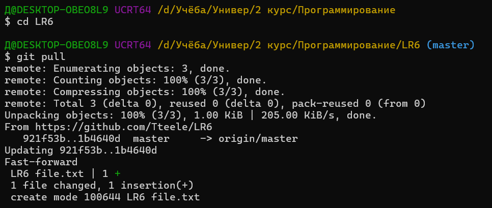

Получены истории операций для каждой из веток.

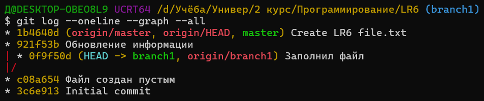

Просмотрены последние изменения.

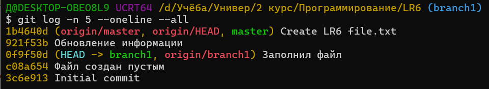

Выполнение слияния в ветку master с ручным разрешением конфликта.

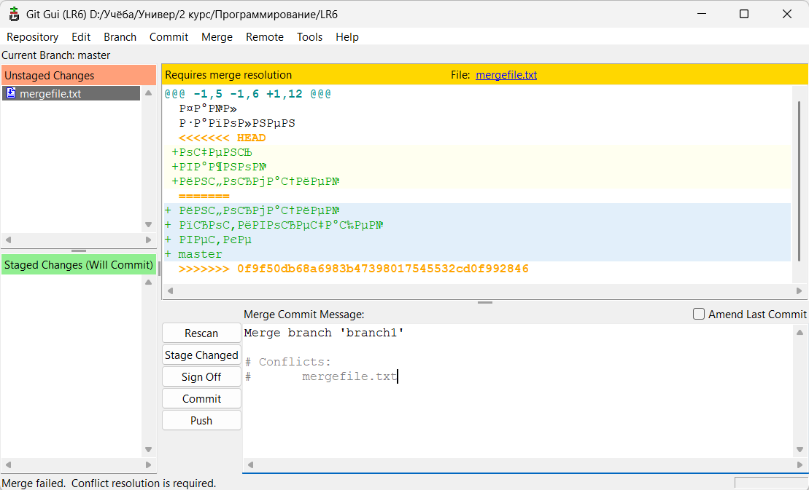

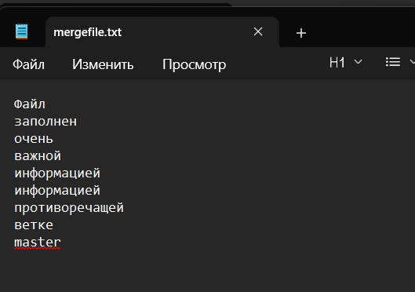

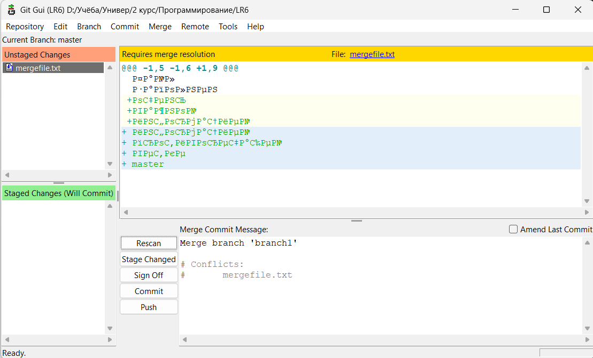

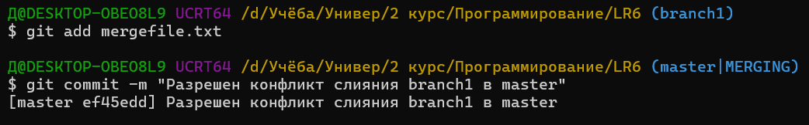

Удаление побочной ветки после успешного слияния.

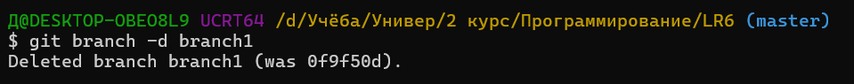

Добавление текста в файл LR6 file.txt с комментарием.

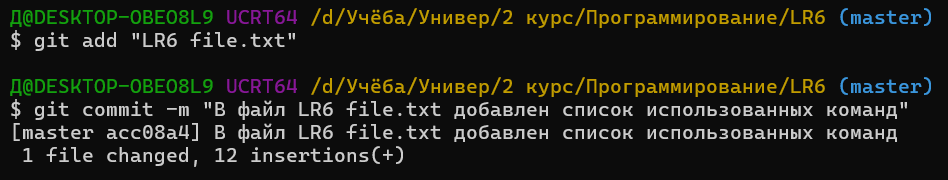

Создание файла Pro Git.txt.

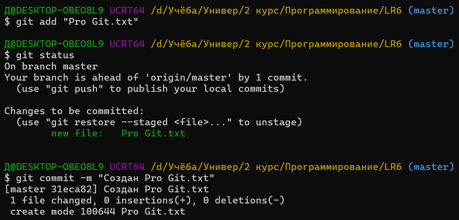

Добавление двух абзацев текста в Pro Git.txt и отправка внесенных изменений на GitHub.

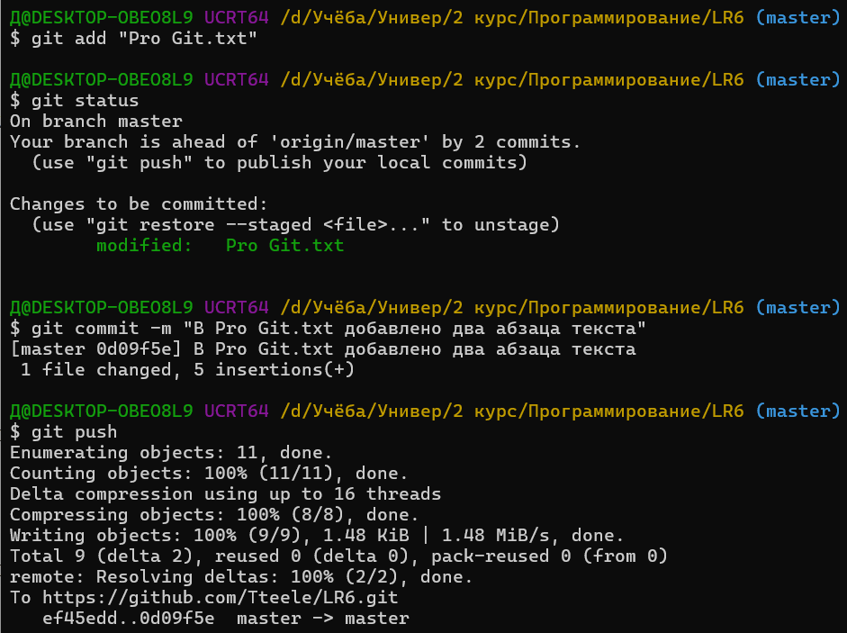

Добавление третьего абзаца текста в Pro Git.txt.

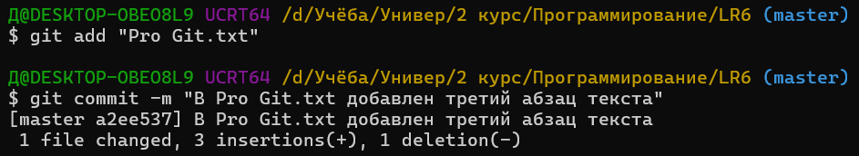

Выполнение отката коммита.

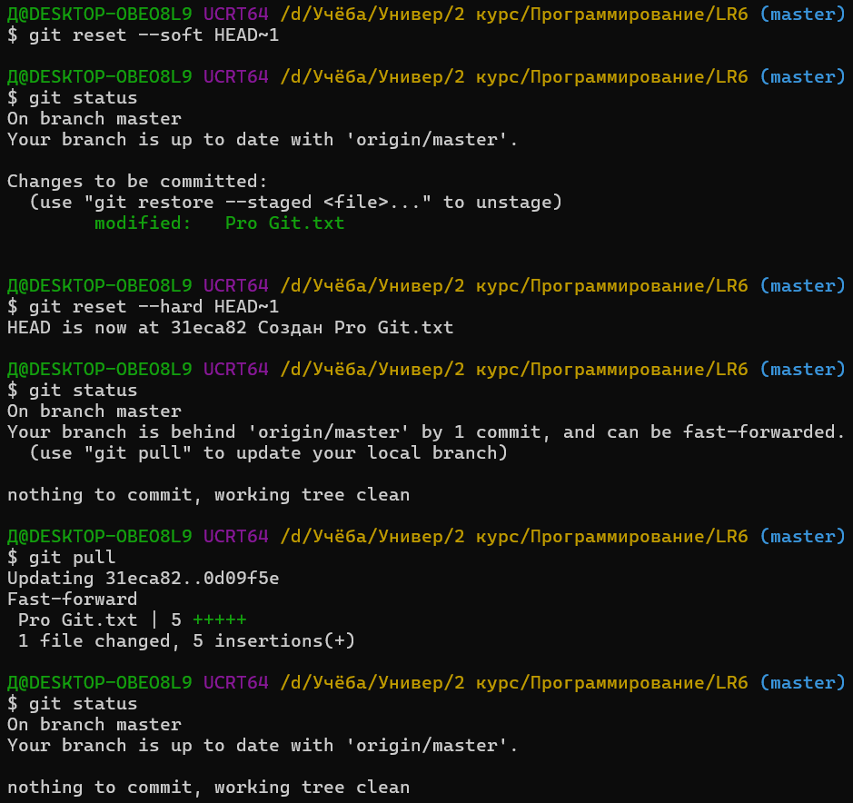

Создание ветки для отчета.

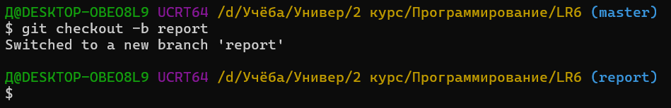

Оформление отчета в файле README.md.

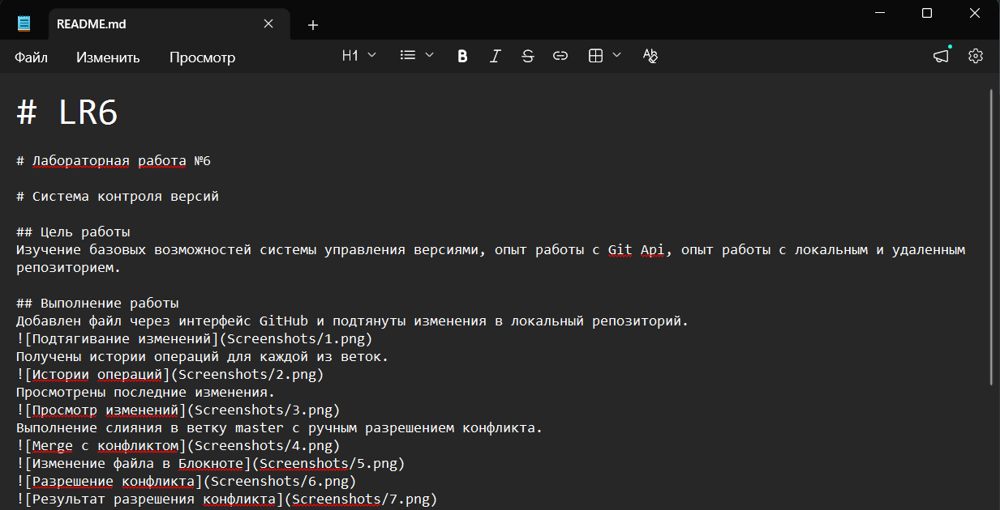

### Лог команд

* git config --global
* git clone
* git pull
* git checkout
* git log --oneline --graph --all
* git log -n 5 --oneline --all
* git add
* git commit -m ""
* git branch -d
* git push
* git status
* git reset --soft HEAD\~1
* git reset --hard HEAD\~1
* git checkout -b

### История операций

8f75faf | 2026-11-15 | Tteele | Исправление изоражений в файле README.md

59c3a78 | 2026-11-15 | 4541в Дуленко Т.А. | Попытка 3 отображения изображения 1 в файле README.md

d26a963 | 2026-11-15 | 4541в Дуленко Т.А. | Попытка 2 отображения изображения 1 в файле README.md

bf0fe7d | 2026-11-15 | 4541в Дуленко Т.А. | Попытка отображения изображения 1 в файле README.md

35071e9 | 2026-11-15 | 4541в Дуленко Т.А. | Борьба с отображением картинок в файле README.md

fe64b06 | 2026-11-15 | 4541в Дуленко Т.А. | Редактирование изображений в файле README.md

0764fa4 | 2026-11-15 | 4541в Дуленко Т.А. | Исправление разметки в файле README.md

1f5c8b3 | 2026-11-15 | 4541в Дуленко Т.А. | Исправления в файле README.md

a04bb84 | 2026-11-15 | 4541в Дуленко Т.А. | В файл README.md добавлена история операций и сделано финальное сохранение

2a23f7a | 2026-11-15 | 4541в Дуленко Т.А. | В папке Screenshots переименованы изображения и добавлен один скрин

cbd83d7 | 2026-11-15 | 4541в Дуленко Т.А. | В файл README.md добавлены лог команд и вывод

b57956a | 2026-11-15 | 4541в Дуленко Т.А. | В файл README.md добавлено выполнение работы

cb8fd1b | 2026-11-15 | 4541в Дуленко Т.А. | В файл README.md добавлены название ЛР и цель работы

e26c72a | 2026-11-15 | 4541в Дуленко Т.А. | В ветку report добавлена папка Screenshots с изображениями

0d09f5e | 2026-11-14 | 4541в Дуленко Т.А. | В Pro Git.txt добавлено два абзаца текста

31eca82 | 2026-11-14 | 4541в Дуленко Т.А. | Создан Pro Git.txt

acc08a4 | 2026-11-14 | 4541в Дуленко Т.А. | В файл LR6 file.txt добавлен список использованных команд

ef45edd | 2026-11-14 | 4541в Дуленко Т.А. | Разрешен конфликт слияния branch1 в master

1b4640d | 2026-11-14 | Tteele | Create LR6 file.txt

921f53b | 2020-11-21 | Kurtyanik | Обновление информации

0f9f50d | 2020-11-21 | Kurtyanik | Заполнил файл

c08a654 | 2020-11-21 | Kurtyanik | Файл создан пустым

3c6e913 | 2020-11-21 | Kurtyanik | Initial commit

### Вывод

Изучены базовые возможности системы управления версиями, получен опыт работы с Git Api и опыт работы с локальным и удаленным репозиторием.

